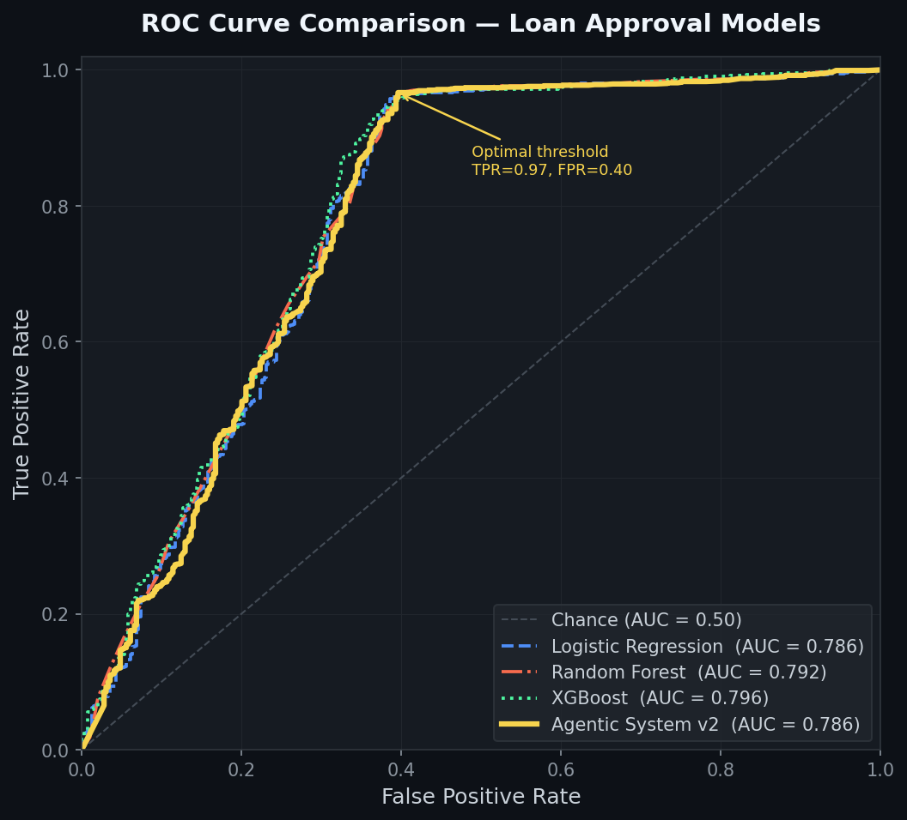
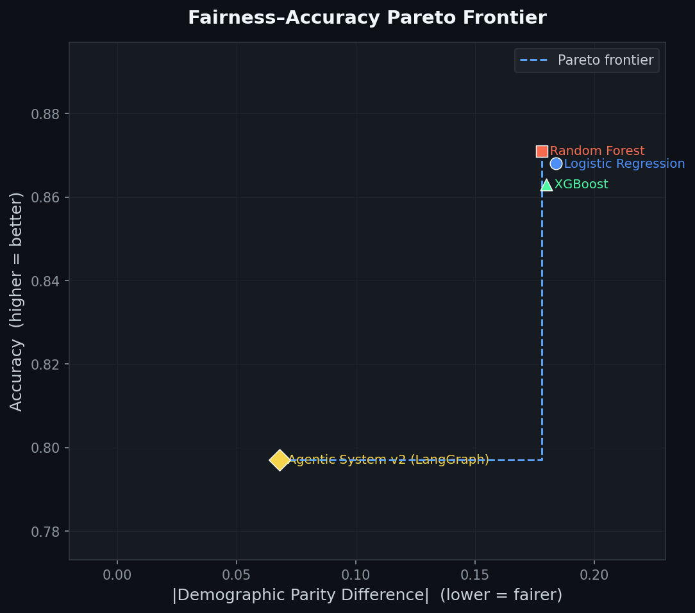

# Formal Fairness Metrics Evaluation (v2 — Enhanced Risk Scoring)

This table compares the **enhanced** Agentic AI system against standard ML baselines on a synthetic credit dataset with historical demographic bias.

## Comparative Results

| Model                         |   Accuracy |   F1 Score |   Demographic Parity Diff |   Equalized Odds Diff | Escalation Rate   |
|:------------------------------|-----------:|-----------:|--------------------------:|----------------------:|:------------------|
| Logistic Regression           |      0.868 |      0.915 |                     0.184 |                 0.261 | 0.0%              |
| Random Forest                 |      0.871 |      0.917 |                     0.178 |                 0.24  | 0.0%              |
| XGBoost                       |      0.863 |      0.911 |                     0.18  |                 0.255 | 0.0%              |
| Agentic System v2 (LangGraph) |      0.797 |      0.875 |                     0.068 |                 0.041 | 4.8%              |

## Agentic Pipeline Telemetry

- **Hard Rejects** (pre-screening): 7 (0.5%)
- **Hard Fast-Tracks** (pre-screening): 83 (5.5%)
- **Fairness Escalations**: 72 (4.8%)

## ROC Curve Comparison

The ROC curves compare the true-positive rate vs false-positive rate for each model across all decision thresholds. AUC closer to 1.0 = better discrimination.

## Fairness–Accuracy Pareto Frontier

Each point is one model. The ideal model sits at the **top-left** corner: highest accuracy (y-axis) and lowest bias / Demographic Parity Diff (x-axis). The Agentic System should dominate all baselines on this frontier.

## Scoring Improvements (v2)

| # | Improvement | Description |
|---|-------------|-------------|
| 1 | Dynamic Confidence Weighting | ML weight ranges 0.4–0.8 based on prediction confidence |
| 2 | Exponential Default Penalties | Compounding penalty: 1 default=+10, 2=+30, 3=+70 (capped) |
| 3 | 3 New Risk Factors | Loan tenure, job stability (years), loan purpose |
| 4 | Risk Interaction Penalty | +20 when ≥3 danger flags fire simultaneously |
| 5 | Creditworthiness Bonus | Up to -15 points for excellent profiles |
| 6 | Hard Override Pre-Screening | Instant reject/fast-track for extreme profiles |

### Metrics Explanation

- **Demographic Parity Diff**: Difference in approval rates between Male and Female applicants. Closer to 0 is fairer.
- **Equalized Odds Diff**: Difference in error rates between groups. Closer to 0 is fairer.
- **Escalation Rate**: Percentage of applications routed to human reviewers by the Fairness Agent.
